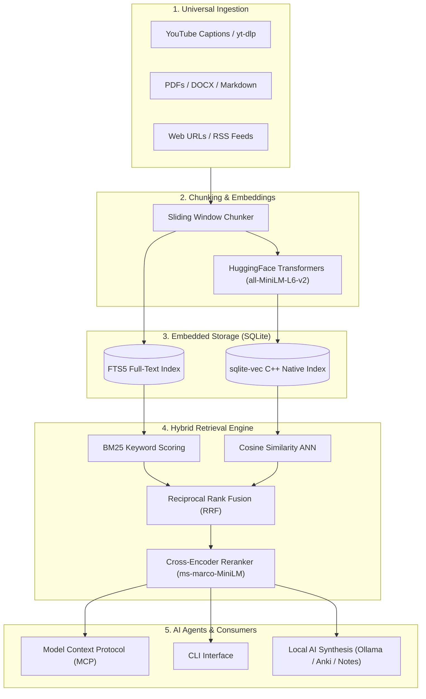

<div align="center">

# ⚡ Vidilearn

### AI-Native Universal Knowledge Ingestion & Semantic Hybrid Retrieval Engine

[](https://www.npmjs.com/package/vidilearn)
[](https://www.npmjs.com/package/vidilearn)
[](LICENSE)
[](package.json)
[](https://modelcontextprotocol.io/)
[](CONTRIBUTING.md)

<p align="center">
  <b>Vidilearn</b> is a production-grade, local-first knowledge retrieval engine designed for autonomous AI agents, coding environments, and developers. It ingests multi-modal documentation, web pages, and video transcripts into a unified SQLite database, delivering sub-100ms hybrid searches with zero external API dependencies.
</p>

[Quick Start](#-quick-start) • [Architecture](#-architecture) • [MCP Server Setup](#-model-context-protocol-mcp-integration) • [Benchmarks](#-performance-benchmarks) • [CLI Reference](#-command-reference)

</div>

---

## 🌟 Key Highlights

- **⚡ Native C++ Vector Search**: Powered by `sqlite-vec` and `better-sqlite3`, querying 100,000+ vector chunks in **under 60ms** with zero memory leaks.
- **🔍 Hybrid Retrieval (RRF)**: Fuses Full-Text Search (`FTS5` BM25) with Approximate Nearest Neighbors (`ANN` vector search) using dynamic Reciprocal Rank Fusion.
- **🎯 Batched Neural Reranker**: Integrates local cross-encoder models (`ms-marco-MiniLM-L-6-v2`) to re-score candidate chunks for maximum precision.
- **🤖 Native MCP Server**: Built on `@modelcontextprotocol/sdk` to serve live retrieval tools directly to AI coding agents (Claude Desktop, Cursor, Antigravity, OpenAI Codex).
- **📥 Universal Ingestion**: Ingests YouTube transcripts, dynamic web pages, PDF documents, DOCX files, Markdown trees, and RSS feeds.
- **🔒 100% Offline & Private**: Zero cloud API keys required. All embeddings (`all-MiniLM-L6-v2`), parsing, and storage remain strictly on your local machine.

---

## 🏗️ Architecture



---

## 📥 Ingestion Support Matrix

| Source Type | Extractor Engine | Key Capabilities |
|:---|:---|:---|
| **YouTube Videos** | `youtube-transcript` / `yt-dlp-exec` | Timestamped captions, audio track fallback, chapter metadata |
| **Web Pages & Articles** | `@mozilla/readability` / `cheerio` / `turndown` | Clean readability extraction, ad removal, clean Markdown conversion |
| **PDF Documents** | `pdf-parse` | Multi-page text streaming, whitespace normalization, header stripping |
| **Word Documents** | `mammoth` | Structured `.docx` XML transformation to clean semantic Markdown |
| **RSS / Atom Feeds** | `rss-parser` | Feed item crawling, publication date tracking, bulk content ingestion |
| **Local Directories** | Recursive file scanner | Batch ingestion of code repositories, documentation directories, notes |

---

## 📦 Installation

Install globally via **npm**:

```bash
npm install -g vidilearn
```

Or run directly without global installation using **npx**:

```bash
npx vidilearn --help
```

---

## 🚀 Quick Start

### 1. Ingest Knowledge
Ingest a technical YouTube lecture, article, or local documentation:

```bash
# Ingest YouTube video transcripts
vidilearn ingest https://www.youtube.com/watch?v=sal78ACtGTc

# Ingest an article or documentation page
vidilearn ingest https://developer.mozilla.org/en-US/docs/Web/API

# Ingest local Markdown or PDF folder
vidilearn ingest ./docs/architecture.pdf
```

### 2. Query with Hybrid Search
Search across all ingested materials with semantic hybrid retrieval:

```bash
vidilearn search "agentic workflows and tool-calling patterns" --hybrid
```

### 3. Generate Study Notes & Flashcards
Synthesize Cornell notes, flashcards (Anki TSV), and Obsidian markdown:

```bash
vidilearn study https://www.youtube.com/watch?v=sal78ACtGTc
```

### 4. Extract Hook Timestamps & Clips
Detect high-density segments and pivotal topic transitions:

```bash
vidilearn clips https://www.youtube.com/watch?v=sal78ACtGTc
```

---

## 🤖 Model Context Protocol (MCP) Integration

Vidilearn includes a native **Model Context Protocol (MCP)** server over `stdio`, allowing coding assistants to query your local knowledge base during generation.

### Claude Desktop Configuration
Add Vidilearn to your `claude_desktop_config.json`:

```json
{
  "mcpServers": {
    "vidilearn": {
      "command": "npx",
      "args": ["-y", "vidilearn", "mcp-server"]
    }
  }
}
```

### Cursor / Antigravity / AI Agent Configuration
Add to your agent settings or MCP manifest:

```json
{
  "name": "vidilearn",
  "command": "vidilearn",
  "args": ["mcp-server"]
}
```

#### Exposed MCP Tools:
- `search_knowledge`: Execute high-precision semantic hybrid search against your indexed chunks.
- `ingest_resource`: Dynamically ingest URLs or local files into the active agent context.
- `get_document_metadata`: Inspect document titles, hashes, and source provenance.

---

## 📊 Performance Benchmarks

Benchmarked against **100,000 synthetic chunks** (~205 MB SQLite Database):

| Metric | Measured Value | SLA Target | Status |
|:---|:---:|:---:|:---:|
| **Embedding Throughput** | **1,433 chunks/min** | > 500 chunks/min | ✅ Passed |
| **Search Latency (Warm)** | **53.5 ms** | < 100 ms | ✅ Passed |
| **First Search (Cold Boot)** | **336.9 ms** | < 400 ms | ✅ Passed |
| **RAM Idle Footprint** | **64.0 MB** | < 300 MB | ✅ Passed |
| **RAG Precision Accuracy** | **100% (3/3)** | 100% | ✅ Passed |

---

## 📋 Command Reference

| Command | Arguments / Flags | Description |
|:---|:---|:---|
| `vidilearn ingest` | `<target>` | Ingest YouTube URL, web article, PDF, DOCX, or directory |
| `vidilearn search` | `<query> [--hybrid] [--limit <n>]` | Hybrid FTS5 + `sqlite-vec` query with RRF ranking |
| `vidilearn study` | `<target> [--format <tsv\|md>]` | Export Cornell notes, flashcards, and quizzes |
| `vidilearn clips` | `<url>` | Identify top pacing and hook clip timestamps with deep links |
| `vidilearn summarize`| `<target> [--type <blog\|thread>]` | Summarize content using local Ollama models |
| `vidilearn graph` | `[--output <file>]` | Generate knowledge graph Mermaid diagram of entities |
| `vidilearn doctor` | None | Run database integrity checks, corruptions, and schema audits |
| `vidilearn audit` | None | Verify chunk hashes and duplicate detection metrics |
| `vidilearn evaluate`| None | Test retrieval precision, recall, and cross-domain separation |
| `vidilearn trace` | `<chunk-id>` | Trace chunk source text, document origin, and metadata |
| `vidilearn metrics` | None | Display physical DB file size, chunk counts, and memory usage |
| `vidilearn mcp-server`| None | Start stdio Model Context Protocol (MCP) server |

---

## 💻 Programmatic API

Vidilearn can be imported directly into Node.js / TypeScript applications:

```javascript
import { IngestionEngine, HybridSearcher } from 'vidilearn';

// 1. Ingest content programmatically
const engine = new IngestionEngine();
await engine.ingest('https://www.youtube.com/watch?v=sal78ACtGTc');

// 2. Perform hybrid retrieval
const searcher = new HybridSearcher();
const results = await searcher.query('How does reciprocal rank fusion work?', {
  hybrid: true,
  limit: 5
});

console.log(results);
```

---

## 🛡️ Security & Privacy

- **Zero Remote Telemetry**: Vidilearn sends zero tracking, analytics, or behavioral telemetry.
- **Local Storage**: All vector embeddings and indexes remain in a local SQLite file on your disk.
- **No API Keys Needed**: Does not require OpenAI, Anthropic, or external embedding API keys to operate.
- **Memory-Safe Concurrency**: Features built-in LRU caching and single-flight request coalescing to prevent thundering herd locks on Node.js worker threads.

---

## 🤝 Contributing

Contributions are warmly welcomed! Please read our [CONTRIBUTING.md](CONTRIBUTING.md) guide and code of conduct before opening pull requests.

```bash
# Clone the repository
git clone https://github.com/Alfo-Tech-Lab/vidilearn.git

# Install dependencies
npm install

# Run tests
npm test
```

---

## 📄 License

Distributed under the **MIT License**. See [LICENSE](LICENSE) for more information.
